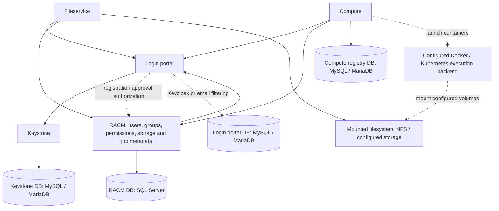
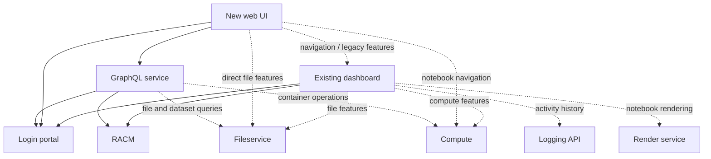

# Service dependencies for toy-data provisioning

This maps the `scarliles/test-data` branch's Helm configuration and application
code. It describes service/API dependencies, not Java build dependencies or a
live cluster inventory. External instances can replace chart-deployed databases
and services. The paused test-service work is outside this map.

For accounts, groups, volumes and their population/cleanup order, see the
[resource dependency and lifecycle map](toydata/README.md). Runner
instructions are in the [integration tests README](README.md).

**Arrow direction: `A --> B` means A depends on or calls B.** Solid edges show
core functional dependencies; dashed edges show feature-specific dependencies.
These are not all startup ordering constraints.

## Core services

RACM is one deployed service: UGM, STOREM and JOBM are areas of its API/model,
not separately deployed servers. Fileservice owns file operations; RACM holds
its volume/resource registrations and permissions. Compute's own database holds
its registry/configuration, while RACM also holds compute-domain and job metadata.

The login portal's RACM dependency is specific to authorization of registration
approval operations. Basic account registration/login uses Keystone; treating
RACM as an unconditional login-portal startup dependency would introduce a
misleading cycle. The baseline toy-data plan assumes approval is disabled;
approval testing is a separate, low-priority scenario. Its SQL database is initialized when Keycloak or email filtering
is enabled. The current chart deploys that database only for Keycloak; email
filtering without Keycloak needs its database provisioned separately.

Fileservice does not require a separate content database: metadata is in RACM,
and bytes/directories live on mounted storage. Its default user volumes can be
created lazily on fileservice access; registering a login account alone is not
proof that its RACM profile and filesystem directories already exist.

Ceph is not an intrinsic prerequisite of this chart's core APIs. If it backs
persistent volumes, an NFS export, or a separately configured object-storage
workflow, include that storage dependency for the deployment in question. This
map does not assume a particular storage provider.

## User interfaces

These arrows include browser-side calls and links, not just server-to-server
requests. A UI pod can serve its shell while a particular downstream feature is
unavailable. GraphQL aggregates existing APIs; it is not the authority for the
underlying identities, permissions or files. UI navigation links alone do not
impose backend startup ordering.

## Optional integrations and supporting services

| Component / feature | Dependencies | Notes |
| --- | --- | --- |
| Application audit producers | RabbitMQ | Login-portal, RACM, fileservice and compute are configured to publish logs. This is a side-channel dependency; failure behavior varies by caller. |
| Log listener | RabbitMQ, logging SQL Server DB | Consumes messages and persists history; disabled by default. |
| Logging API | Logging SQL Server DB, login-portal, RACM | Reads history and uses authentication/authorization. The chart's internal logging DB deployment is gated on the listener being enabled. |
| RabbitMQ-to-Elasticsearch bridge | RabbitMQ, external Elasticsearch | Optional history/search pipeline. |
| Docker COMPM (batch worker) | RACM/JOBM, fileservice, compute | Polls job queues, manages job files and executes jobs through compute. Not a prerequisite for simple user/group data. |
| RDB COMPM | RACM/JOBM, fileservice, configured database servers | SQL-job execution; separate from interactive notebook execution. |
| Keycloak / external SSO | Keycloak and its database, login-portal integration | Conditional on the chosen authentication setup. |
| CasJobs integration | External CasJobs API and configured credentials | Optional account/job integration. |
| Email verification / notifications | SMTP | Conditional on email workflows. |
| Render service | Render runtime; invoked by UI for notebook conversion | Separate from provisioning identities/groups/files. |
| Deploy poller | Kubernetes API, configured Nexus endpoint | Deployment automation, not application-data provisioning. |
| Ingress, DNS, TLS | Cluster routing and deployment configuration | Cross-cutting infrastructure, omitted from each individual arrow. Some server-to-server URLs use the published deployment URL. |

## Startup ordering actually enforced by the chart

The chart explicitly waits for these dependencies when deploying its internal
instances:

- Keystone waits for its database and initializes identity data.
- Login-portal waits for Keystone's initialized users.
- RACM waits for its SQL database and login-portal health.
- Fileservice waits for RACM, then runs its registration bootstrapper before
  starting the main container. The bootstrapper also authenticates through
  login-portal.
- Compute waits for its registry database; its authenticated runtime operations
  additionally need login-portal and RACM.
- The log listener waits for its SQL database when deployed.

These waits are narrower than the functional graph. Configured external hosts
can change which waits are present; a successful startup probe does not establish
that every optional integration or registered execution domain works.

## Implications for toy data

| Data to populate | Services needed beyond the identity/RACM foundation |
| --- | --- |
| Login accounts | Login-portal, Keystone and Keystone DB; configured registration integrations may add requirements. |
| RACM profiles, groups, memberships and permissions | RACM and its SQL DB, plus login-portal/Keystone for authenticated identities. |
| Volume registrations and files/directories | Fileservice and mounted storage, plus the foundation above. Metadata registration and writing bytes are distinct operations. |
| Interactive notebook containers | Compute, its registry DB, a registered domain/image and a working execution backend; storage as required by the selected volumes. |
| Batch jobs | Appropriate COMPM, RACM/JOBM registration and its execution backend, plus job-file storage. |

Start with login accounts and RACM groups/memberships before introducing files
or execution. This is an inference for provisioning order, not a claim that all
objects should be deleted in a single reverse service order. Actual depopulation
must follow resource references/ownership across these services, which needs a
separate [object dependency graph and cleanup plan](toydata/README.md).

## Source pointers

- [Login-portal configuration](../../helm/sciserver/files/login-portal-application.properties)
  and [conditional database initialization](../../components/java/login-portal/src/org/sciserver/sso/AppConfig.java).
- [Login-portal registration approval authorization](../../components/java/login-portal/src/org/sciserver/sso/AuthenticationService.java).
- [Keystone database configuration](../../components/keystone-image/keystone.conf)
  and [startup/bootstrap](../../components/keystone-image/entrypoint.sh).
- [RACM configuration](../../helm/sciserver/files/racm-application.yaml)
  and [startup waits](../../helm/sciserver/templates/racm/service/racm-deployment.yaml).
- [Fileservice configuration](../../helm/sciserver/files/fileservice-application.properties),
  [bootstrap and storage](../../helm/sciserver/templates/fileservice/fileservice-deployment.yaml),
  and [volume metadata initialization](../../components/java/fileservice/src/main/java/org/sciserver/springapp/fileservice/VolumesManager.java).
- [Compute configuration](../../helm/sciserver/files/compute-application.properties)
  and [runtime initialization](../../components/java/compute/src/org/sciserver/compute/AppConfig.java).
- [Dashboard endpoints](../../helm/sciserver/files/dashboard.env.js),
  [web endpoints](../../helm/sciserver/templates/web/web-deployment.yaml),
  and [GraphQL endpoints](../../helm/sciserver/templates/graphql/graphql-deployment.yaml).
- [Logging API configuration](../../helm/sciserver/files/logging-api-application.properties),
  [listener configuration](../../helm/sciserver/files/log-listener-application.properties),
  and [database deployment condition](../../helm/sciserver/templates/logging/db/db-deployment.yaml).
- [COMPM architecture and setup](../../docs/compm/compm.rst).
