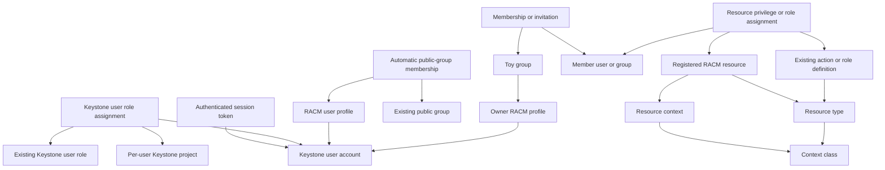
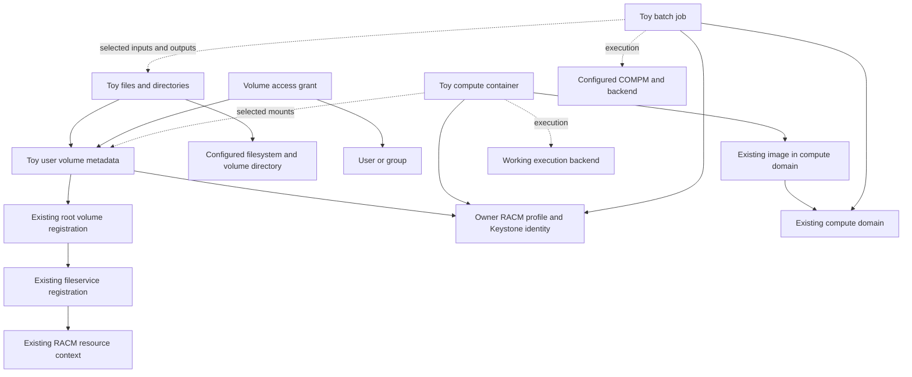

# Toy-data dependencies and lifecycle

This is the resource-level companion to the [service dependency map](../service-dependencies.md).
It describes the APIs and code on this branch, then derives a provisioning and
cleanup plan. **The plan is documentation, not an implemented population tool or
a guarantee of complete cleanup.** No existing service changes are assumed.

The baseline toy-data plan assumes registration approval is disabled. Testing
approval is a separate, low-priority scenario, not a prerequisite for population.
For this baseline, the service foundation is Keystone/database, then login-portal,
then RACM; the conditional login-portal-to-RACM approval dependency is inactive.

The [integration tests README](../README.md) describes how to
run the imported tests. Their current mutations are inventoried below.

## Proposed concrete toy-data layers

The main test targets are RACM, fileservice and compute. Login-portal/Keystone
provide identities and sessions, with registration approval disabled. Populate
the layers in the order below; unwind execution before storage, and storage
and access relationships before identities. This is the proposed dataset, not
a description of fixtures the current tests already provide.

### 1. RACM: users, groups and memberships

Establish test identities through login-portal, then make authenticated RACM
requests to materialize their profiles. Create two ordinary user-owned groups,
`toy-group-a` and `toy-group-b`, and wire memberships to provide these personas:

| Persona | Group A | Group B | Purpose |
| --- | --- | --- | --- |
| A-only user | Member | None | Allowed in A, denied in B. |
| B-only user | None | Member | Allowed in B, denied in A. |
| Both user | Member | Member | Allowed in both. |
| Neither user | None | None | Denied in both despite being authenticated. |

Track group owners separately from these access personas; ownership can confer
additional rights and must not accidentally invalidate a denied-access scenario.
The names above are logical labels; actual created names should identify their
dataset instance. Record accounts, RACM profiles, owner/member relationships and
implicit public memberships in the operation journal.

This layer supplies fixtures for RACM membership and permission checks and the
identities used by the next two layers. Its unwinders remove owned grants,
membership links and groups while retaining owner access until cleanup finishes.
Account/profile cleanup remains subject to the API gaps documented below;
designated reusable test accounts are an option, not a requirement already chosen.

### 2. Fileservice: NFS-backed dummy volumes and content

Use a dedicated toy-data directory on a deployment host (which may itself be a
VM), exported over NFS. Configure fileservice and compute to access that same
backing storage. No separate ephemeral container storage is needed for this
plan, and no particular storage provider such as Ceph is required beneath it.

Separate backing setup from dataset population:

- **Backing setup:** establish the host directory/export, fileservice mount and
  root-volume configuration, and the compute mount mappings. Reuse a suitable
  existing root volume where possible; if a dedicated root is needed, configure
  it explicitly. Exact paths, export settings and registration parameters are
  deployment inputs still to be specified.
- **Dataset population:** create explicit dummy user volumes owned by test users,
  backed by distinct directories beneath the toy-data area. Add private volumes
  and volumes shared with group A or group B. Record every created registration,
  directory and access grant; do not treat all content on the export as owned.
- **Known content:** populate a small, deterministic directory tree with text
  files whose paths and contents can be asserted. These fixtures support listing,
  read/write and denied-access tests and later compute mount checks. Exact file
  names and the read/write sharing matrix remain to be defined.

Volume unwinders remove the dataset's bytes and registrations through the owning
APIs and reconcile both. Default-volume side effects are tracked separately.
The NFS export and dedicated backing directory can remain for subsequent runs;
retaining that infrastructure is distinct from leaving toy volume content behind.

### 3. Compute: two domains on the existing Kubernetes cluster

Configure two dedicated toy compute domains, A and B, using the same Kubernetes
cluster that hosts SciServer. A domain is logical configuration; neither domain
requires a separate cluster. The existing compute code has Kubernetes execution
backends and NFS volume support, but domain setup is not implied by installing
the compute service's Helm workload.

- Grant access to domain A through group A and domain B through group B. Verify
  effective permissions, including any inherited/public grants, so the neither
  and single-group personas actually lack the intended access.
- Initially expose the same suitable container image in both domains, reducing
  differences unrelated to authorization. Image choice and exact domain settings
  remain deployment inputs.
- Configure Kubernetes API access/permissions, workload placement/routing as
  needed, and mappings to the toy NFS-backed volumes. Use different volume access
  in A and B to exercise permitted and forbidden storage combinations.
- Launch disposable containers as the access personas. Check domain discovery
  and creation permissions, container lifecycle, selected volume mounts, and
  access to known content. Include denied creation attempts, not only hidden UI
  entries. Shared-cluster domains test SciServer authorization boundaries; they
  do not by themselves establish Kubernetes or host-level isolation.

Keep domain/image registrations and backend configuration as reusable fixture
setup, distinct from each scenario's containers. Record whether each setup object
was created or borrowed. Scenario unwinders delete containers and associated
execution resources before storage cleanup. Full fixture teardown additionally
removes toy-owned domain configuration/grants after all execution has ended;
the exact registration and teardown operations still need implementation-specific
verification. Batch jobs/COMPM are a later extension, not required for this initial
interactive-container dataset.

### Journal and unwinder boundary

Each layer consists of logical operations, each represented by one durable
journal entry with a single unwinder entry point. For example: establish an
identity, create a group, populate a volume, configure a domain, or launch a
container. An operation records partial API progress and implicit resources,
so its unwinder can resume after failure. Cross-layer dependencies are recorded
explicitly rather than inferred only from the layer number. See the
[ownership and journal design](#ownership-record-for-a-future-population-tool).

## Reading the graphs

`A --> B` means A requires or references B. Create prerequisites first, working
against the arrows; remove dependents first, working with the arrows. These are
logical/API relationships, not a complete SQL foreign-key diagram. A dependency
does not imply automatic cascading deletion.

Solid edges describe resource relationships; dashed edges describe credentials
or execution prerequisites. Shared deployment configuration is normally borrowed,
not created or deleted by a toy-data run.

## Identity, groups and access

Registration through login-portal creates a Keystone project, user and role
assignment. A subsequent authenticated RACM request can lazily create the RACM
profile and add it to the existing `public` group. Record both the Keystone user
ID and RACM profile ID: they identify different records.

A group's owner must already exist. Membership/invitation records require both
the group and the member; the member can itself be a group. Create all toy groups
before linking them, and remove membership links before deleting referenced
groups. This separates object creation from graph wiring even when a dataset
contains nested groups. Do not assume arbitrary membership cycles are accepted.

Privileges and role assignments connect a principal to a resource and an action
or role. They are relationship objects, not ownership of the underlying resource.
In particular, granting access to a shared deployment resource never makes that
resource eligible for toy-data deletion. Resource-owned groups and service
volumes have additional service-token checks; use their owning service rather
than treating them as ordinary user-owned objects.

## Storage and execution

The domain/image branches are prerequisites to be selected for a particular
scenario; a batch job does not necessarily use the same domain as an interactive
container. Containers may also select data volumes or volume containers beyond
the user-volume subset shown here.

Volume metadata and filesystem content are separate state. RACM's unregister
operations do not remove bytes. Fileservice's user-volume deletion first removes
the directory (or asks a configured quota manager to do so), then unregisters the
volume in RACM. Failure between those operations requires reconciliation.

Fileservice also creates configured default user volumes/directories lazily.
Even the user-volume delete handler calls `createDefaultUserVolumes` before
deleting its target. Deleting one default volume and then accessing fileservice
again can recreate it; deleting several defaults sequentially is therefore not
a reliable way to reach an empty account. Empty parent directories can remain
as well. Prefer explicit toy volumes or a dedicated subtree in an existing
volume for repeatable datasets, and inventory implicit defaults separately.

Stop and delete toy compute containers, and confirm batch work has stopped,
before removing their files, volumes or access grants. Cancellation is a request,
not evidence that a worker has stopped using its inputs or producing outputs.

## Solving the population order

Treat each row as a phase; independent objects within a phase can be populated
in parallel. Skip branches the dataset does not use. For the concrete dataset
above, NFS backing and the two toy domains are established as explicit fixture
setup before scenarios borrow them; setup itself must track created resources.

| Phase | Populate / establish | Required evidence before continuing |
| --- | --- | --- |
| 0 | Check the service foundation and resolve borrowed prerequisites: public group, fileservice/root volumes, resource definitions, domains/images and backends as needed. | Registration approval is disabled, APIs are reachable and selected prerequisites exist; do not create replacement deployment infrastructure implicitly. |
| 1 | Create toy accounts through login-portal and authenticate them. | Keystone user IDs and project identities recorded; usable owner credentials available. |
| 2 | Materialize RACM profiles through authenticated requests. | RACM IDs recorded separately from Keystone IDs; implicit public memberships accounted for. |
| 3 | Create toy groups and explicit volumes/resources using the appropriate existing APIs. | Stable returned IDs and ownership recorded, including discovered default volumes. |
| 4 | Add memberships, invitations and resource grants; write toy files/directories. | Relationship endpoints and created paths recorded; intended access checked. |
| 5 | Launch optional containers/jobs referencing the populated resources. | Execution IDs recorded and resulting state observed. |

Groups and volumes do not depend on one another until a share/grant links them.
This is a partial order, not a requirement to serialize every API call.

## Solving the depopulation order

Cleanup needs two graphs: resource references and **the credentials needed to
delete those resources**. Preserve owner access until its last dependent cleanup
operation succeeds. An administrator in RACM is not automatically a Keystone
administrator, and a service token is a different capability again.

1. Quiesce the dataset: prevent further population, stop/delete containers and
   request job cancellation. Observe execution termination before proceeding.
2. Remove toy content or explicit toy volumes through fileservice while owner
   credentials and needed access remain valid. Reconcile bytes and metadata.
3. Revoke remaining toy grants/shares and remove memberships/invitations,
   including links from other groups to toy groups. A parent deletion may cascade
   its own children; verify the resulting state rather than assuming every link
   in another object disappeared.
4. Delete toy groups and any other toy-owned resource registrations through their
   owning APIs. Never delete borrowed root volumes, service registrations,
   domains/images, built-in groups or resource definitions.
5. Reconcile remaining account-level state, including default volumes, RACM
   profiles, public memberships and job history. The API gaps below mean this
   phase cannot currently promise a complete reset.
6. End owner sessions only after owner-dependent cleanup is complete. Delete toy
   login accounts with the separate Keystone-admin-authorized login-portal API
   if account deletion is part of the dataset policy. Verify the per-user project
   is gone too; account/project deletion is sequential, not one transaction.

On any failure, retain unresolved records and the credentials needed to retry.
Do not report success merely because the login account or Kubernetes Job is gone.

## Existing API capabilities and cleanup gaps

Paths below are relative to the deployment base URL. Authorization must be
checked for the actual operation; this table is not a proposal to add privileges
to existing services.

| Resource | Existing cleanup path / implementation | Constraint |
| --- | --- | --- |
| Login account and per-user project | `DELETE /login-portal/api/users/{userId}`; `ApiControllerV2.usersDelete`, `KeystoneService.unregisterUser` | Requires a token passing Keystone `isAdmin`; optional CasJobs deletion runs first. Does not invoke RACM/fileservice/compute cleanup. |
| RACM profile and automatic public membership | `UserProfileSource.getOrCreateUserProfile` creates them lazily. | RACM still has no user-profile deletion endpoint. Test-service now supports opt-in, broker-scoped cleanup of dependency-free profiles; see [RACM deletion](racm-deletion.md). |
| Ordinary user-owned group | `DELETE /racm/ugm/rest/groups/{groupid}`; `UsersAndGroupsManager.deleteGroup` | Implementation requires the owner; built-in `public`/`admin` groups are protected. Resource-owned groups also check the service token. Group-owned membership rows have ORM cascade/orphan removal; external references still need verification. |
| File or directory | `DELETE /fileservice/api/data/{topVolume}/...`; `ApiController.deleteData` | Requires access to the target; use the returned/recorded volume identity and exact toy path. File upload uses `/api/file/...`, but deletion uses `/api/data/...`. |
| Ordinary user volume, including bytes | `DELETE /fileservice/api/volume/{rootVolume}/{ownerName}/{userVolume}`; `ApiController.deleteUserVolume` | Handler requires the authenticated username to equal the owner and RACM's delete action. Default-volume creation can occur during deletion. |
| User-volume metadata only | RACM STOREM `FileServiceUserRequiredController.deleteUserVolume` and `FileServiceRepository.deleteUserVolume` | Does not delete bytes; resource-owned volumes require the service-volume path. Removing metadata first can make byte cleanup harder. |
| Container | Compute `ApiController.deleteContainer` or `UiController.delete` | API deletion checks `X-Service-Auth-ID`; UI deletion uses the owner's authenticated session. The UI path also handles an attached Dask cluster. These paths are not interchangeable credentials or behavior. |
| Batch job | `POST /racm/jobm/rest/jobs/{jobId}/cancel`; `JOBMRESTController.cancelJob` | Cancellation is asynchronous. No general job-history deletion endpoint was found in the inspected JOBM controllers; terminal history may remain. |
| Audit/history and external integrations | Component-specific retention and administration. | Logging, email, CasJobs and external SSO can create additional state; no cross-service rollback exists. |

Complete account-level erasure is therefore **not solved by a reverse topological
sort alone**. With existing services unchanged, a practical first dataset can
reuse designated test accounts and clean up its explicitly owned groups, paths
and volumes. Strict return-to-baseline, including profiles/defaults/history,
needs a separately agreed administrative reset strategy or an isolated disposable
deployment. Guarded, broker-scoped SQL profile cleanup is now implemented in test-service;
see the [deletion dependency investigation](racm-deletion.md).

## Ownership record for a future population tool

This is a proposed tool contract, not functionality already implemented here:

- Maintain a durable operation journal. Each entry represents one logical
  population operation (not each HTTP request) and identifies a single unwinder
  function as its compensation entry point. An operation may involve several
  API calls and resources; record their progress and returned IDs incrementally
  in that entry. The unwinder uses the recorded state, handles partial completion
  and repeated invocation, and reports any unresolved resources. Cleanup follows
  operation dependencies while preserving required owner credentials. This is
  compensating cleanup, not an atomic cross-service transaction or a guarantee
  of an exact inverse. Journal storage technology is not yet decided.
- Give each dataset instance an ID. Record logical names, returned service IDs,
  owner IDs, dependency IDs, cleanup operation and state for every created object
  and relationship. Use names as labels, not as the sole proof of ownership.
- Distinguish **created**, **borrowed** and **implicitly created** resources. Only
  created or explicitly attributable implicit resources are cleanup candidates.
  A share on a borrowed resource can be owned by the dataset even when the
  resource itself is not.
- Record intent before mutation and reconcile ambiguous responses/timeouts before
  retrying creation. Save each successful result immediately so partial population
  still has a cleanup plan. Do not infer absence from permission or network errors.
- Keep credentials in protected session state, separate from a shareable ownership
  manifest. Record which credential is required without publishing its secret.
- Cleanup resumes from recorded state, checks postconditions, and reports residuals
  explicitly. Use targeted checks that do not recreate the resource being checked;
  fileservice access can materialize defaults.

## What the imported tests currently create

These describe the merged broker/runner tests, not the proposed toy-data tool.
The broker tracks account ownership and retries abandoned account cleanup;
tests register in-process cleanup hooks, which forced termination can prevent.
The logical-operation journal and complete cross-service cleanup are not yet implemented.

| File and function | Created or potentially materialized state | Current teardown |
| --- | --- | --- |
| `test_register.py`: `TestRegister.test_register` | Broker-reserved identity registered through login-portal, per-user project/role assignment and session token. | Runner releases the reservation; broker handles verified account cleanup and retries. Partial creation may require reconciliation/manual review. |
| `test_register.py`: `TestRegister.test_token` and subsequent authenticated RACM calls | RACM profile and public membership on first access. | None. |
| `test_api.py`: `TestApi.test_fileservice_basic_volumes`, `test_fileservice_tree`, `test_fileservice_upload_file` | Default volumes/directories can materialize on fileservice access. Upload creates a randomly named file under `Storage/{user}/persistent`. | Upload registers `deleteCreatedFile` before mutation. Default volumes/directories are not comprehensively removed. |
| `test_api.py`: `TestApi.test_racm_create_group` | Random group and owner membership. | Registers `deleteCreatedGroup` before creation. |
| `test_api.py`: `TestApi.test_compute_create_container` | Container in a selected existing domain/image, with `X-Description: NOTEBOOK`. | Registers `deleteCreatedContainer` after a successful response with a parsed ID. Ambiguous creation responses still need reconciliation. |
| `test_logout.py`: `TestLogout.test_logout` | Ends a separate brokered logout-fixture session. | Revocation is tested without invalidating other fixtures; runner/broker account cleanup is separate. |

The other current tests are read/validation checks, subject to lazy profile or
volume creation on the authenticated services they contact. Audit events may be
produced by both mutations and reads.

## Source references

- [Keystone account/project creation and deletion](../../../components/java/login-portal/src/org/sciserver/sso/keystone/KeystoneService.java)
  and [login-portal account API](../../../components/java/login-portal/src/org/sciserver/sso/controllers/ApiControllerV2.java).
- [Lazy RACM profiles](../../../components/java/racm/src/main/java/org/sciserver/springapp/racm/login/UserProfileSource.java),
  [UGM API](../../../components/java/racm/src/main/java/org/sciserver/springapp/racm/ugm/controller/UserManagementRESTController.java),
  [group operations](../../../components/java/racm/src/main/java/org/sciserver/springapp/racm/ugm/application/UsersAndGroupsManager.java),
  and [group membership mapping](../../../components/java/racm/src/main/java/edu/jhu/user/UserGroup.java).
- [RACM resource model](../../../components/java/racm/src/main/resources/RACM.vo-urp.xml).
- [Fileservice mutations and default-volume initialization](../../../components/java/fileservice/src/main/java/org/sciserver/springapp/fileservice/controller/ApiController.java),
  [STOREM API](../../../components/java/racm/src/main/java/org/sciserver/springapp/racm/storem/controller/FileServiceUserRequiredController.java),
  and [metadata deletion](../../../components/java/racm/src/main/java/org/sciserver/springapp/racm/storem/application/FileServiceRepository.java).
- [Compute API](../../../components/java/compute/src/org/sciserver/compute/controllers/ApiController.java)
  and [owner-facing compute operations](../../../components/java/compute/src/org/sciserver/compute/controllers/UiController.java).
- [JOBM API](../../../components/java/racm/src/main/java/org/sciserver/springapp/racm/jobm/controller/JOBMRESTController.java)
  and [RDB job API](../../../components/java/racm/src/main/java/org/sciserver/springapp/racm/jobm/controller/RDBJobRESTController.java).
- [Current integration test sources](..).
